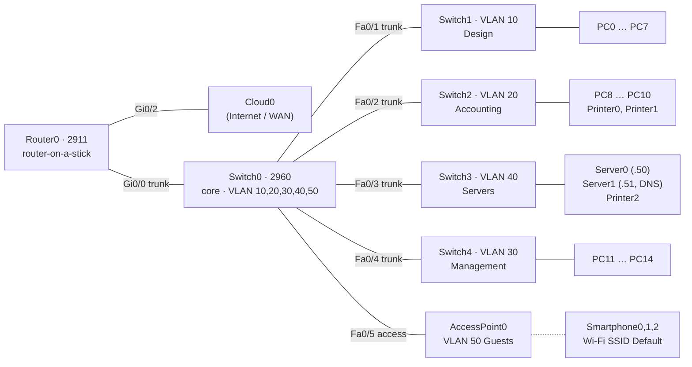

# Разбор схемы `a.pkt`

Файл: Packet Tracer **8.0.0.0212**, 32 устройства, 27 связей (плюс 3 смартфона по Wi-Fi).

## Логическая топология

## Подсети и шлюзы (router-on-a-stick)

| VLAN | Имя | Подсеть | Шлюз | DHCP pool | Примечание |
|---|---|---|---|---|---|
| 10 | Design | 192.168.7.0/28 | 192.168.7.1 | POOL_DESIGN | DNS 192.168.7.51 |
| 20 | Accounting | 192.168.7.16/28 | 192.168.7.17 | POOL_ACC | |
| 30 | Management | 192.168.7.32/28 | 192.168.7.33 | POOL_MGMT | |
| 40 | Servers | 192.168.7.48/28 | 192.168.7.49 | — | Server0 .50, Server1 .51 |
| 50 | Guests | 192.168.7.64/27 | 192.168.7.65 | POOL_GUESTS | AP + смартфоны |

Интерфейсы роутера: `Gi0/0.10`, `Gi0/0.20`, `Gi0/0.30`, `Gi0/0.40`, `Gi0/0.50`
(encapsulation dot1Q), `Gi0/2` — в Cloud0, `Gi0/1` — shutdown.

## Ethernet-связи

| От | Порт | К | Порт | Кабель |
|---|---|---|---|---|
| Router0 | Gi0/0 | Switch0 | Gi0/1 | straight |
| Router0 | Gi0/2 | Cloud0 | Ethernet6 | straight |
| Switch0 | Fa0/1 | Switch1 | Gi0/1 | crossover |
| Switch0 | Fa0/2 | Switch2 | Gi0/1 | crossover |
| Switch0 | Fa0/3 | Switch3 | Gi0/1 | crossover |
| Switch0 | Fa0/4 | Switch4 | Gi0/1 | crossover |
| Switch0 | Fa0/5 | Access Point0 | Port 0 | straight |
| Switch1 | Fa0/1…0/8 | PC0…PC7 | Fa0 | straight |
| Switch2 | Fa0/1…0/5 | Printer0, Printer1, PC8…PC10 | Fa0 | straight |
| Switch3 | Fa0/1…0/3 | Server0, Server1, Printer2 | Fa0 | straight |
| Switch4 | Fa0/1…0/4 | PC11…PC14 | Fa0 | straight |

Смартфоны (3 шт.) подключены к Access Point0 по Wi-Fi; в файле это не линки,
а беспроводная ассоциация (SSID `Default`).

## Вариант `lab_18.pkt` (переставленные зоны, сеть 192.168.18.x)

| VLAN | Имя | Подсеть | Шлюз | Цвет зоны |
|---|---|---|---|---|
| 10 | Design | 192.168.18.0/28 | 192.168.18.1 | голубая |
| 20 | Accounting | 192.168.18.16/28 | 192.168.18.17 | зелёная |
| 30 | Management | 192.168.18.32/28 | 192.168.18.33 | оранжевая |
| 40 | Servers | 192.168.18.48/28 | 192.168.18.49 | сиреневая |
| 50 | Guests | 192.168.18.64/27 | 192.168.18.65 | бирюзовая |

Серверы: Server0 — 192.168.18.50, Server1 — 192.168.18.51 (DNS).
Конфиги устройств, VLAN-базы и связи не менялись — только адреса и расположение.
